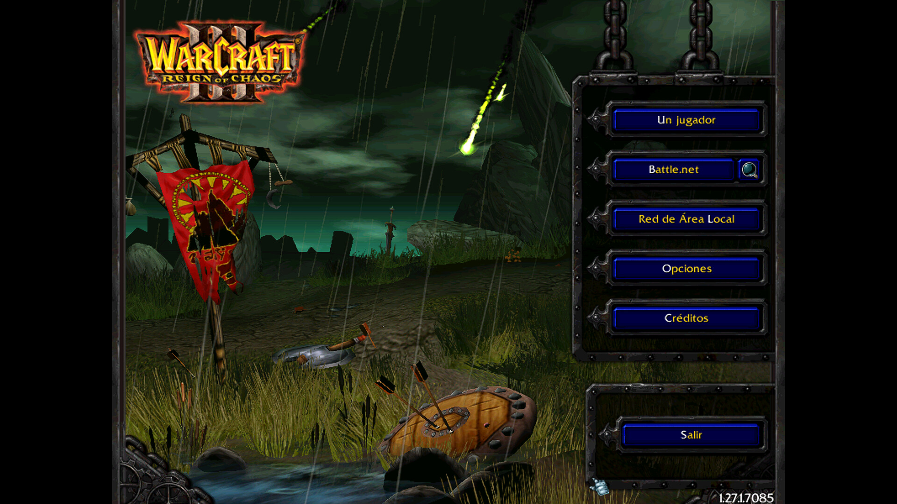
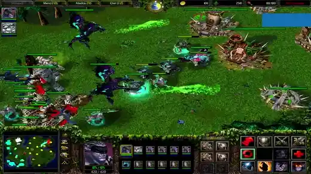

# wc3lan

Play classic **Warcraft III 1.27b** (build 1.27.1.7085) on networks that are
not a plain LAN: Tailscale, ZeroTier, WireGuard, or two different subnets.

It does not modify the game. It replaces one DLL (`ijl15.dll`) with a small
proxy that copies the LAN discovery packets to the other players' addresses.

## Why this exists

My friends and I always wanted to play Warcraft III together, but we live on
different networks and the game only finds matches on a plain LAN. So I made
this fix.



## Demo



[Full video (36 s, 720p)](docs/warcraft3lanfix.mp4)

## Tested

| Setup | Result |
|---|---|
| 4 players, mixed Windows and Linux (Lutris/Wine), over Tailscale | Works |

Game version: **1.27.1.7085** (shown in the bottom right corner of the main
menu). Tested with the Spanish client. In English the menu entry is
**Local Area Network** (in Spanish: **Red de Área Local**).

## Download

Grab the zip from the [releases page](https://github.com/jhoniwana/warcraft3lanfix/releases):

- `wc3lan-windows.zip` for Windows
- `wc3lan-linux.zip` for Linux with Lutris/Wine

## Windows

1. Install **Tailscale** and log in to the same tailnet as your friends.
2. In your Warcraft III folder, rename `ijl15.dll` to `ijl15_orig.dll`.
   **The backup must use exactly that name:** the shim loads `ijl15_orig.dll`
   to forward the original functions. Any other name will not work.
3. Copy the `ijl15.dll` from the zip into that folder.
4. Let `war3.exe` through the Windows Firewall (UDP and TCP 6112).
5. Open the game and go to **Local Area Network**.

**Antivirus note:** this project replaces a DLL in the game folder, so some
antivirus tools may flag it as a false positive. The source code is in this
repo and you can build it yourself (see below).

## Linux (Lutris/Wine)

1. Install **Tailscale** and log in.
2. Run:

   ```bash
   ./install-linux.sh "/path/to/WarCraft III"
   ```

   It installs the shim and enables automatic peer discovery.
3. Start the game with Lutris (Wine runner).
4. Open the game and go to **Local Area Network**.

## Requirements

- Warcraft III **1.27b (build 1.27.1.7085)**, your own copy. Nothing from
  Blizzard is distributed here.
- Tailscale on every machine, logged in to the same tailnet.
- ZeroTier also works without any setup (its network forwards broadcast).
- Windows: allow `war3.exe` through the firewall.

## How it works

The game looks for matches by broadcasting to `255.255.255.255:6112`.
Broadcast never leaves your subnet, so nobody on a VPN can see it.

The proxy hooks the game's own send call and, for every LAN packet, also sends
a copy by **unicast** to each peer (Tailscale addresses, local subnets). The
answers arrive at the game's own socket and from the real peer address, so the
game lists the match and connects normally. No extra program, no proxying, no
port changes.

## Troubleshooting

`wc3lan.log` is created next to `war3.exe`. A healthy start looks like:

```
shim loaded: 7 peers
hooked 1 sendto slot(s) in game.dll
sendto socket bound to 0.0.0.0:6112
```

- **Nothing appears:** check that both machines are on the same tailnet and
  that `war3.exe` is allowed through the firewall.
- **Two copies of the same match appear** when both players are on the same
  WiFi *and* on Tailscale. Harmless; it is the same match seen through two
  paths.
- **`could not hook game.dll` or the game does not start:** the shim was not
  loaded. Check that both `ijl15.dll` and `ijl15_orig.dll` are in the game
  folder and that the backup is named **exactly** `ijl15_orig.dll`.
- **Different game version:** this was tested only on 1.27.1.7085. Other
  builds may not hook correctly.

## Uninstall

Copy `ijl15_orig.dll` back over `ijl15.dll` and delete `wc3lan.log`.

## Build from source

Requires Go and `i686-w64-mingw32-gcc`:

```bash
make
```

## Legal

This project is not affiliated with or endorsed by Blizzard Entertainment.
It ships no Blizzard files: no game data, no original DLLs, no installers and
no keys. You need your own copy of Warcraft III 1.27b.

The shim replaces `ijl15.dll` in your own installation and keeps the original
as `ijl15_orig.dll`. Uninstalling restores it.

## License

MIT. See [LICENSE](LICENSE).

## More

- [docs/rea-findings.md](docs/rea-findings.md): reverse engineering notes.
- `cmd/wc3lan`: a Go CLI used during the investigation (not needed to play).
